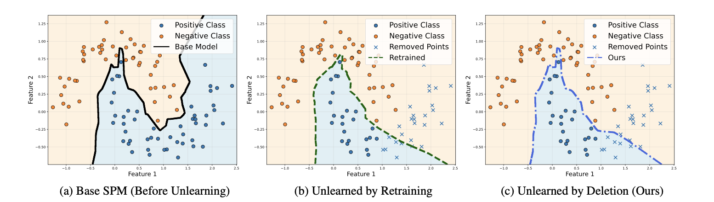

# Designing to Forget: Deep Semi-parametric Models for Unlearning

**CVPR 2026**

[Amber Yijia Zheng](https://amberyzheng.github.io/)\*, [Yu-Shan Tai]()\*, [Raymond A. Yeh](https://raymond-yeh.com/)

Department of Computer Science, Purdue University


<!-- [[Paper]](https://arxiv.org/abs/XXXX.XXXXX) -->

<p align="center">
  
</p>

**TL;DR:** We introduce deep semi-parametric models (SPMs) that enable exact machine unlearning by simply deleting training samples at test time — no retraining or parameter updates required.

<details>
<summary><b>Abstract</b></summary>

Recent advances in machine unlearning have focused on developing algorithms to remove specific training samples from a trained model. In contrast, we observe that not all models are equally easy to unlearn. Hence, we introduce a family of deep semi-parametric models (SPMs) that exhibit non-parametric behavior during unlearning. SPMs use a fusion module that aggregates information from each training sample, enabling explicit test-time deletion of selected samples without altering model parameters. Empirically, we demonstrate that SPMs achieve competitive task performance to parametric models in image classification and generation, while being significantly more efficient for unlearning. Notably, on ImageNet classification, SPMs reduce the prediction gap relative to a retrained (oracle) baseline by 11% and achieve over 10x faster unlearning compared to existing approaches on parametric models.
</details>

---

## Setup

### 1. Environment
We recommend using Conda to manage your environment:
```bash
conda create -n spm python=3.10 -y
conda activate spm

# Install dependencies
pip install -r requirements.txt
conda install pytorch::faiss-gpu
```

### 2. ImageNet Data Preparation
1. **Download:** Get the dataset from the [Kaggle ImageNet Challenge](https://www.kaggle.com/competitions/imagenet-object-localization-challenge/data).
2. **Preprocess:** Use the [REPA preprocessing script](https://github.com/sihyun-yu/REPA/tree/main/preprocessing) to structure the data correctly.

---

## Pretraining SPM Models

### Optional overfitting mitigation

The isolated [`overfitting_mitigation/`](./overfitting_mitigation/) package
provides opt-in, episode-safe regularization, stronger augmentation, EMA/SWA,
early stopping, gradient clipping, and reproducible checkpoint metadata. It
does not change `main.py` or ordinary experiments; see its README for exact
commands and compatibility notes.

### Methodology report

See [`docs/methodology_report.md`](/home/neillucha/SNU/proj/MUL/spm_unlearning/docs/methodology_report.md)
for the mathematical methodology of the base SPM, deletion-aware and K-means
models, overfitting mitigation, and dataset reduction methods.

### Additional CIFAR-100, Tiny ImageNet, and ImageNet support

Dedicated, isolated configurations and scripts are under
[`cross_dataset_support/`](/home/neillucha/SNU/proj/MUL/spm_unlearning/cross_dataset_support/).
They cover standard and K-means training, random/EL2N/K-center selection,
single-GPU ImageNet configurations, and the Tiny ImageNet datamodule.

### Training curves for standard `main.py` runs

Standard training also writes live curves when a
`ModelCheckpoint` callback has a configured `dirpath`. Under that checkpoint
directory, `training_configuration_curves/` contains:

```text
last-<experiment-tag>.png
last-<experiment-tag>.csv
```

For a reduced-dataset run, both curve basenames also append the actual
subset identifier:

```text
last-<experiment-tag>-sel<subset-id>.png
last-<experiment-tag>-sel<subset-id>.csv
```

Both files are updated after training epochs and completed validation runs.
The CSV columns are `epoch`, `train_acc`, `val_acc`, `train_loss`, and
`val_loss`; values remain blank until the corresponding metric is available.

Train a standard SPM model for the target task.

### Image Classification
```bash
# CIFAR-10
bash scripts/classification/run_cls_cifar.sh $GPU_ID

# CIFAR-100 (original SPM classifier)
PYTHONPATH=. CUDA_VISIBLE_DEVICES=$GPU_ID python main.py \
  --config config/classification/cifar100_resnet18.yaml \
  --seed 0

# ImageNet
bash scripts/classification/run_cls_imagenet.sh $GPU_ID
```

### Image Generation (DDPM)
```bash
# CIFAR-10
bash scripts/generation/run_ddpm.sh $GPU_ID
```

## Additional Herding and Moderate Coreset reductions

Herding and Moderate Coreset implementations are isolated under
[`reduction_comparison/`](/home/neillucha/SNU/proj/MUL/spm_unlearning/reduction_comparison).
They generate the same `spm_dataset_reduction` JSON structure used by the
existing datamodules, and store all scripts and subsets inside that folder.
See [`reduction_comparison/README.md`](/home/neillucha/SNU/proj/MUL/spm_unlearning/reduction_comparison/README.md)
for commands.

## Support-set reduction comparison

The isolated [`support_reduction/`](./support_reduction/) experiment creates
10%-through-90% support subsets for EL2N + class-wise K-center Greedy,
class-wise Random, Moderate, and Herding. It also evaluates all subsets for a
seed and creates per-method and combined metric plots. See
[`support_reduction/README.md`](./support_reduction/README.md) and its
[`useful_commands.txt`](./support_reduction/useful_commands.txt) for exact
commands and output locations.

## Optional EL2N + K-center dataset reduction

Dataset reduction is opt-in. It computes class-wise EL2N exclusions with a
pilot SPM checkpoint, then applies deterministic class-wise farthest-first
K-center selection to the remaining training examples. Validation and test
queries are never reduced. Selection artifacts are kept separately under
`results/dataset_selection/` and can be reused by later training runs.

Generate a subset from the repository root:

```bash
PYTHONPATH=. python3 scripts/select_dataset.py \
  --config config/classification/cifar_resnet18.yaml \
  --pilot-checkpoint results/classification/cifar_resnet18/last.ckpt \
  --output-dir results/dataset_selection/cifar10 \
  --seed 7 \
  --el2n-low-exclusion-pct 10 \
  --el2n-high-exclusion-pct 5 \
  --kcenter-retention-pct 50
```

EL2N exclusions are class-wise by default. To apply the low/high EL2N
exclusions globally across all eligible training examples, add:

```bash
--el2n-global
```

Use `--el2n-class-wise` to state the default behavior explicitly. K-center
Greedy remains class-wise in both modes.

Precompute and cache EL2N scores once for a pilot checkpoint:

```bash
PYTHONPATH=. python3 scripts/compute_el2n_scores.py \
  --config config/classification/cifar_resnet18.yaml \
  --pilot-checkpoint results/classification/cifar_resnet18/last.ckpt \
  --support-size 256 \
  --batch-size 64 \
  --seed 7 \
  --output-dir results/dataset_selection/el2n_scores
```

For a pilot named `last.ckpt`, the default score file is named
`results/dataset_selection/el2n_scores/last-el2n_scores.pt`, with companion
metadata at `last-el2n_scores_metadata.json`.

Reuse cached EL2N scores while creating a subset:

```bash
PYTHONPATH=. python3 scripts/select_dataset.py \
  --config config/classification/cifar_resnet18.yaml \
  --pilot-checkpoint results/classification/cifar_resnet18/last.ckpt \
  --el2n-scores results/dataset_selection/el2n_scores/last-el2n_scores.pt \
  --el2n-low-exclusion-pct 10 \
  --el2n-high-exclusion-pct 5 \
  --kcenter-retention-pct 50
```

All selection stages print terminal progress and timing. EL2N scoring and
embedding extraction use progress bars with elapsed time and estimated remaining
time. Cached-score reuse prints the alignment/load status, while EL2N filtering,
random selection, and class-wise K-center Greedy report stage and class progress
with elapsed totals. If `tqdm` is unavailable, the scripts fall back to regular
percentage/count log updates.

When `--el2n-scores` is omitted, `select_dataset.py` retains its original
behavior and recomputes EL2N scores. Cached scores are validated against the
pilot checkpoint, config, dataset size, class eligibility, support size, and
original indices before reuse.

Train a fresh final SPM model from that subset:

```bash
PYTHONPATH=. python3 main.py \
  --config config/classification/cifar_resnet18.yaml \
  --dataset-reduction \
  --selection-artifact results/dataset_selection/cifar10/selection-<id>.json \
  --seed 7
```

The pilot weights are never loaded by `main.py`; they are used only by the
selection command. Reduction parameters, retention, class counts, pilot path,
seed, and artifact path are stored in the final checkpoint hyperparameters and
copied into evaluation metrics.

For a reproducible random subset, use `scripts/select_random.py`. The
percentage is the percentage retained. By default it is sampled globally;
`--class-wise` applies the percentage independently within each class:

```bash
PYTHONPATH=. python3 scripts/select_random.py \
  --config config/classification/cifar_resnet18.yaml \
  --selection-pct 50 \
  --class-wise \
  --seed 7 \
  --output-dir results/dataset_selection/random/cifar10
```

Use the resulting JSON with `main.py` in the same way as an EL2N/K-center
artifact.

---

## SPM Unlearning: Classification

> **Note:** For all evaluation scripts, ensure you modify `--ckpt_path` in the `.sh` file to point to your pretrained SPM checkpoint.

### Class-wise Unlearning
Unlearn specific classes (1 or 5) and automatically generate the retrained baseline.
```bash
# CIFAR-10 ($NUM_CLASS_UNLEARN: 1 or 5)
bash scripts/eval/eval_cls_cifar.sh $GPU_ID $NUM_CLASS_UNLEARN

# ImageNet
# Modify --datadir inside the script to your IMAGENET_DATA_PATH
bash scripts/eval/eval_cls_imagenet.sh $GPU_ID
```

### Random Unlearning
For reproducibility, generate and save the random indices first:
```bash
# Example: Generate indices for a specific ratio
python random_unlearn_index_generate.py --ratio 0.5 --outpath random_unlearn_idx/
```
Then, execute the unlearning:
```bash
# $RATIO: e.g., 0.1 or 0.5
bash scripts/eval/eval_cls_cifar_rand.sh $GPU_ID $RATIO
```

---

## SPM Unlearning: Image Generation

### 1. Train Retrained Baselines
Retrained SPMs for unlearning evaluation.
```bash
bash scripts/generation/run_ddpm_retrain.sh $GPU_ID
```

### 2. Execute Unlearning (Sample + UA + FIR_R)
Run the unlearning process for DDPM. Update the `--ckpt_path` to your pretrained or retrained model.
```bash
bash scripts/eval/eval_ddpm.sh $GPU_ID
```

### 3. Evaluation: FID_O
Calculate the **FID_O** metric proposed in our paper to compare the distribution of the unlearned model against the retrained model.
```bash
# Pass the paths to your retrained (real) and unlearned (fake) image folders
bash scripts/eval/eval_ddpm_fid_diff.sh --real_path $RETRAIN_IMG_PATH --fake_path $UNLEARN_IMG_PATH --out_path ./results/fid/
```

---

## Project Structure

```
.
├── main.py                         # Training entry point
├── main_retrain.py                 # Retrain baseline entry point (excludes specified classes)
├── evaluate.py                     # Evaluation entry point (unlearning metrics + generation)
├── fid_diff.py                     # FID_O metric computation
├── random_unlearn_index_generate.py
├── config/                         # YAML configs for classification and generation
├── dataset/                        # PyTorch Lightning DataModules (CIFAR-10, ImageNet)
├── models/
│   ├── spm_classifier.py           # Semi-parametric classifier (MoE + PairwiseRelationExpert)
│   └── spm_ddpm.py                 # Semi-parametric DDPM
├── nets/
│   ├── resnet.py                   # ResNet encoder for CIFAR-scale images
│   ├── unet_spm.py                 # SPM-augmented UNet with SemiParametricMiddleBlock
│   └── ddpm_cond.py                # DDPM with support conditioning (DDIM sampling + CFG)
├── evaluation/
│   ├── comp_classification_metrics.py  # Unlearning metrics (UA, RA, MIA)
│   ├── fid_diffusion.py            # Sample generation + FID computation
│   └── cls_acc_edm.py              # Classification accuracy on generated images
├── utils/                          # Config loading, dataset utilities, logging
└── scripts/                        # Shell scripts for training and evaluation
```

---

## Citation

If you find this work useful, please cite:

```bibtex
@inproceedings{zheng2026designing,
  title={Designing to Forget: Deep Semi-parametric Models for Unlearning},
  author={Zheng, Amber Yijia* and Tai, Yu-Shan* and Yeh, Raymond A.},
  booktitle={Proceedings of the IEEE/CVF Conference on Computer Vision and Pattern Recognition (CVPR)},
  year={2026}
}
```
